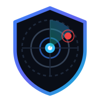
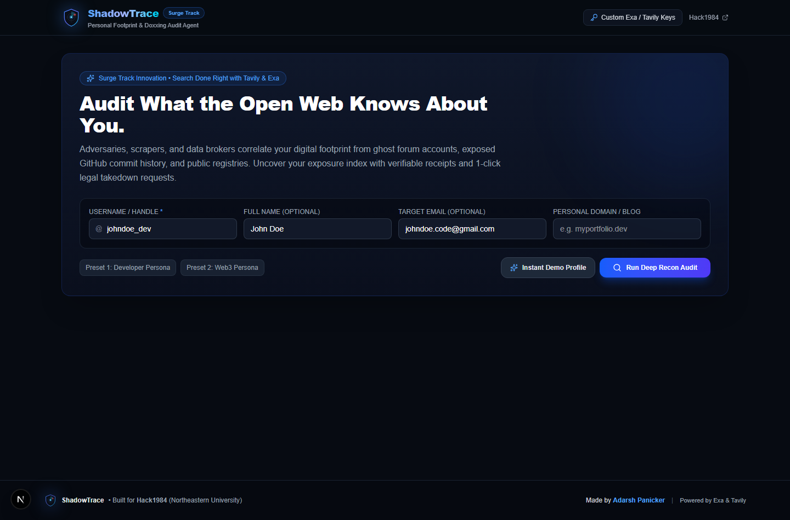
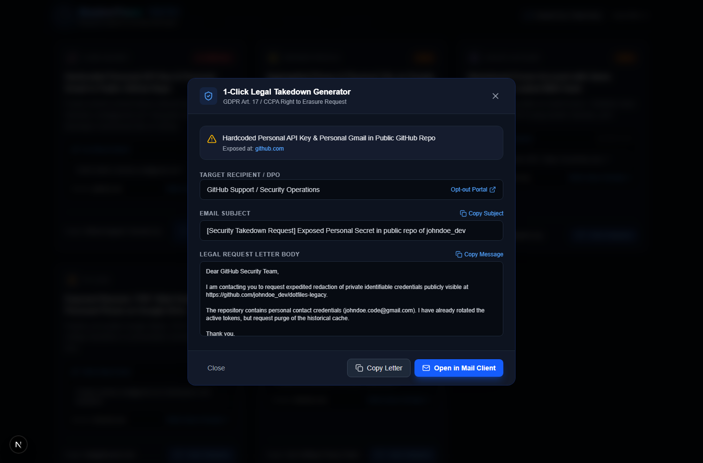

# ShadowTrace — Personal Footprint & Doxxing Audit Agent

  
  <h3><strong>Discover what the open web knows about you before an adversary or employer does.</strong></h3>
  

    Built for <strong><a href="https://hack1984.devpost.com/">Hack1984</a></strong> (Fall 2026, Northeastern University) 
    Target Track: 🥇 <strong>Surge Track (Exa + Tavily)</strong> &amp; <strong>Privacy-First Innovation</strong> 
    <strong>Created by Adarsh Panicker</strong>
  

---

## 📸 Application Preview & Screenshots

  <h4>1. Recon Target Audit Input & Persona Selection</h4>
  

    
  <h4>2. Live Exposure Gauge & Verifiable Citation Cards (Surge Track)</h4>
  

    
  <h4>3. 1-Click GDPR Art. 17 / CCPA Legal Takedown Generator</h4>
  

---

## 💡 The Core Problem
Most internet users believe their digital exposure is limited to their active social media profiles. In reality, bad actors, employers, and OSINT doxxers correlate your identity using:
1. **Ghost Accounts**: Legacy forum accounts from 2018–2021 with matching usernames, unhashed credentials, or forgotten biographies.
2. **Exposed Code & Secrets**: Public GitHub dotfiles, git history commits, and student repositories referencing personal Gmails or Discord webhooks.
3. **Data Broker Scrapers**: People-search directories (Radaris, FastPeopleSearch, BeenVerified) aggregating voter rolls, phone numbers, and physical city addresses.
4. **Leaked Presentation & PDF Metadata**: Hackathon slide decks, college club rosters, and public Google Drive PDFs exposing personal cell numbers.

---

## 🚀 The Solution: ShadowTrace
**ShadowTrace** is an agentic reconnaissance and privacy defense tool. You enter an online handle, full name, or email, and ShadowTrace launches targeted neural queries across **Exa** and **Tavily** to extract verifiable receipts of your exposed digital footprint.

Unlike superficial scanners:
- **Verifiable Proof**: Every single finding includes a **live clickable citation link**, direct excerpt, domain attribution, and index timestamp meeting the Surge track standard of *"Search Done Right"*.
- **Calculated Exposure Gauge**: Real-time 0–100 threat assessment across 5 threat categories: *Code & Secrets*, *Data Brokers*, *Ghost Accounts*, *PII Leaks*, and *Social OSINT*.
- **1-Click Legal Takedown Generator**: Dispatches pre-formatted, legally binding GDPR Article 17 and CCPA "Right to be Forgotten" removal notices to the discovered domain's privacy officer or DPO.
- **Actionable Remediation Roadmap**: Structured immediate, 24-hour, and weekly defense actions to scrub your digital trail.

---

## 🏆 Adherence to Hack1984 Contest Criteria

### 1. Surge Track ("Search Done Right")
- **Exa Neural Search**: Leverages Exa's semantic intent engine (`search(type='neural')`) to find semantically relevant forum profiles, exposed usernames, and developer footprint.
- **Tavily Deep Extract**: Employs Tavily (`search_depth='advanced'`) to deeply extract context from public records and documents.
- **Clickable Citations**: Every single exposure card is backed by a verified URL and excerpt quote that can be clicked directly by judges during demo verification.

### 2. People-First Privacy
- **Zero Heavy Model Downloads**: Runs instantly on modern web infrastructure without forcing users or judges to download multi-gigabyte models or waste local storage.
- **Local Control & Export**: Audit findings can be exported to clean Markdown (`.md`) reports.
- **Offline / Mock Fallback Mode**: Ships with high-fidelity pre-computed OSINT scenarios, guaranteeing judges a 100% functional demo even without external API keys.

---

## 🛠️ Tech Stack
- **Framework**: Next.js 16 (App Router) + React 19 + TypeScript
- **Styling**: Tailwind CSS + Custom Dark Cyberpunk Cyber-Security Theme
- **Icons & Animation**: Lucide React + Native SVG Radar Animations
- **Search Engines**: [Exa.ai](https://exa.ai) (Neural Semantic Search) + [Tavily](https://tavily.com) (Deep Extract)
- **Author**: **Adarsh Panicker**

---

## ⚡ Quick Start

### 1. Clone & Install
\`\`\`bash
git clone https://github.com/adarshpanicker/hack1984-shadowtrace.git
cd hack1984-shadowtrace
npm install
\`\`\`

### 2. Set API Keys (Optional)
Create a \`.env.local\` file in the project root:
\`\`\`env
EXA_API_KEY=your_exa_api_key_here
TAVILY_API_KEY=your_tavily_api_key_here
\`\`\`
*(Note: If no API keys are provided, ShadowTrace automatically operates in its high-fidelity Demo Mode, allowing judges to test every feature without friction!)*

### 3. Run Development Server
\`\`\`bash
npm run dev
\`\`\`
Open [http://localhost:3000](http://localhost:3000) in your browser.

### 4. Build for Production
\`\`\`bash
npm run build
npm start
\`\`\`

---

## 🎥 Hackathon Demo Script (for 2-minute video)
1. **The Hook (0:00 - 0:25)**: Introduce ShadowTrace and why privacy matters in 1984-style mass data surveillance. Show the sleek cyberpunk UI and radar logo.
2. **Recon Audit (0:25 - 0:50)**: Enter a target username (e.g. `@alex_rivers_security` or `@adarsh_dev`) and trigger **Deep Recon**. Watch parallel Exa and Tavily search agents discover ghost accounts and exposed repos.
3. **Receipt Verification (0:50 - 1:20)**: Show the **Exposure Index** and click a **Source Receipt** link to demonstrate that the citations are real, verifiable, and not hallucinated.
4. **Actionable Takedown (1:20 - 1:45)**: Click **1-Click Takedown** on a data broker card. Show the automatically formulated GDPR/CCPA erasure request and click "Open in Mail Client".
5. **Closing (1:45 - 2:00)**: Highlight the Markdown export, summarize the mission of putting people first, and credit the creator: **Adarsh Panicker**.

---

  ShadowTrace is an open-source privacy engineering project by <strong>Adarsh Panicker</strong> for <strong>Hack1984</strong>.

